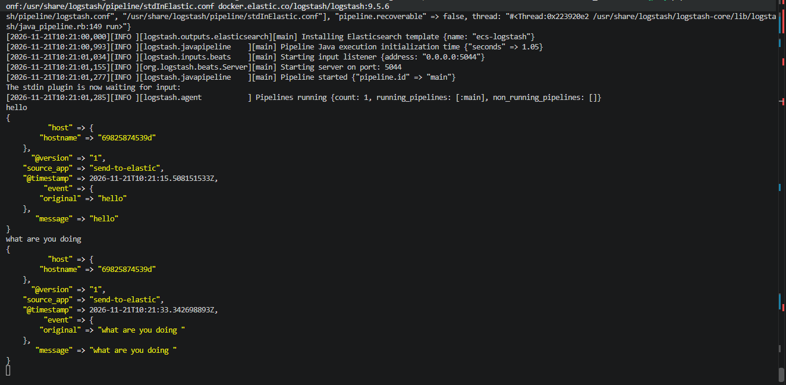
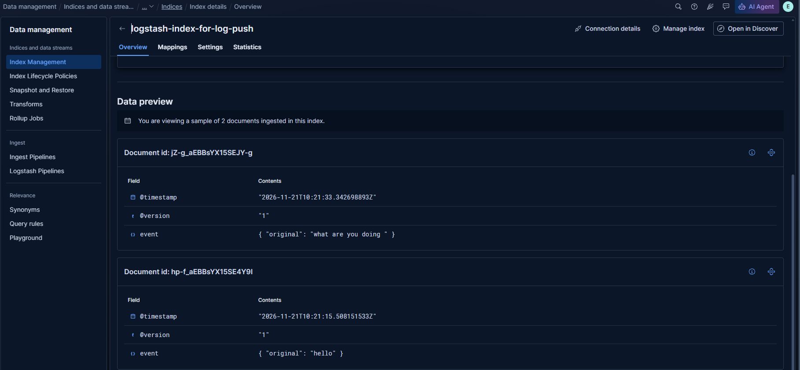
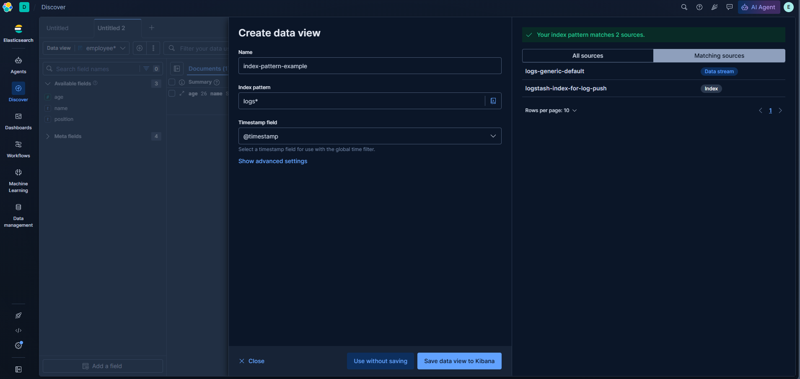
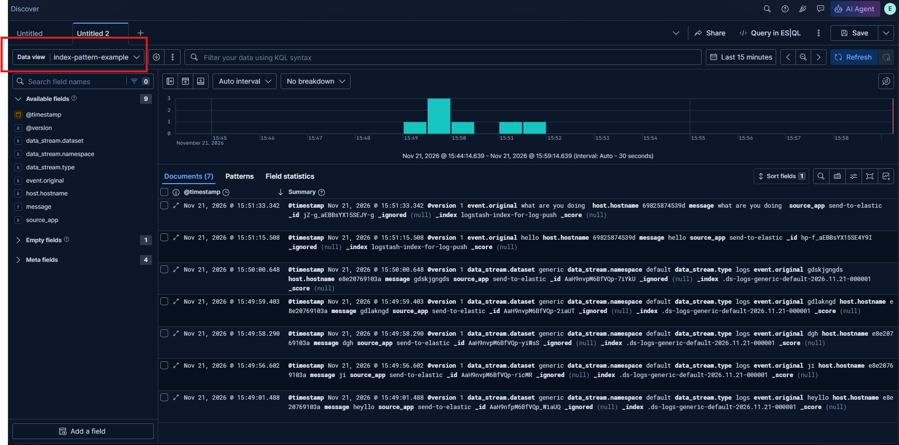

# 🚚 Logstash Configuration and Data Push

> [!NOTE]
> Run these commands from the Logstash folder.

To use Logstash with an existing Elasticsearch and Kibana setup, run the Logstash container separately and connect it to the same Docker network. This allows Logstash to push logs to Elasticsearch.

The Logstash configuration file can be mounted into the container using a volume mount.

## 📄 Run with a Single Configuration File

```bash
docker run -it --rm --name logstash -p 9600:9600 --network elastic-start-local_default -v ${pwd}/pipeline/logstash.conf:/usr/share/logstash/pipeline/logstash.conf docker.elastic.co/logstash/logstash:9.5.6
```

## 📂 Run with Multiple Configuration Files

When all configuration files are placed in the pipeline directory, Logstash loads them into a **single pipeline named `main`**.

```bash
docker run -it --rm --name logstash -p 9600:9600 --network elastic-start-local_default -v ${pwd}/pipeline:/usr/share/logstash/pipeline docker.elastic.co/logstash/logstash:9.5.6
```

Check the running pipelines at:

**http://localhost:9600/_node/pipelines**

```json
{
  "host": "36d447dbd126",
  "version": "9.5.6",
  "http_address": "0.0.0.0:9600",
  "id": "ee83eea2-21af-43f4-b132-fa985496a3a2",
  "name": "36d447dbd126",
  "ephemeral_id": "fedaece2-dad1-44bb-9365-7c275ad7160d",
  "snapshot": false,
  "status": "yellow",
  "pipeline": {
    "workers": 16,
    "batch_size": 125,
    "batch_delay": 50
  },
  "pipelines": {
    "main": {
      "ephemeral_id": "9aeed717-966c-4f18-885f-d694ce8d9a3e",
      "hash": "a8258b2c35030cf6d213c92c11b79a39625d8cadedb8a8424215751278c19192",
      "workers": 16,
      "batch_size": 125,
      "batch_delay": 50,
      "batch_output_chunking_growth_threshold_factor": 1000,
      "dead_letter_queue_enabled": false
    }
  }
}
```

## 🔀 Run with Multiple Pipelines

To create separate pipelines for each configuration file, define all pipeline configurations in a `pipelines.yml` file and mount it into the container. The pipeline directory contains the `.conf` files used by these pipelines.

```bash
docker run -it --rm --name logstash -p 9600:9600 --network elastic-start-local_default -v "${pwd}/pipeline:/usr/share/logstash/pipeline" -v "${pwd}/config/pipelines.yml:/usr/share/logstash/config/pipelines.yml:ro" docker.elastic.co/logstash/logstash:9.5.6
```

Check the running pipelines at:

**http://localhost:9600/_node/pipelines**

```json
{
  "host": "65d630232d86",
  "version": "9.5.6",
  "http_address": "0.0.0.0:9600",
  "id": "1e3ebfdf-1df0-4473-989b-f9a8efdca680",
  "name": "65d630232d86",
  "ephemeral_id": "05628bda-f8a7-4145-bf2c-3c71d8b26f93",
  "snapshot": false,
  "status": "green",
  "pipeline": {
    "workers": 16,
    "batch_size": 125,
    "batch_delay": 50
  },
  "pipelines": {
    "application1": {
      "ephemeral_id": "425919a9-dd80-423a-928f-48e40ca21181",
      "hash": "1c7053448f3ebce7dc1695cb57597ac9c1b0b579eaaa8e96ad24a4d93c27e7ad",
      "workers": 16,
      "batch_size": 125,
      "batch_delay": 50,
      "batch_output_chunking_growth_threshold_factor": 1000,
      "dead_letter_queue_enabled": false
    },
    "application2": { /* from yaml field  */
      "ephemeral_id": "cc75ce82-723f-4b50-8b40-8a2380e5f424",
      "hash": "04b79dcbf9d04d920614342d0ef030cead018def91ce8a0f91a6984d7acd0aa6",
      "workers": 16,
      "batch_size": 125,
      "batch_delay": 50,
      "batch_output_chunking_growth_threshold_factor": 1000,
      "dead_letter_queue_enabled": false
    }
  }
}
```

## 🧩 What Are Pipelines and Why Use Them?

A pipeline is a data-processing flow with three stages:

1. **Input** — Collects data from different sources.
2. **Filter** — Optionally transforms, enriches, or parses the data.
3. **Output** — Sends the processed data to a destination.

Separate pipelines provide isolation and allow you to use different configurations for each pipeline, such as:

- Worker count
- Batch size
- Batch delay

You can also segregate pipelines by application or data source.

## 📤 Push Data from Logstash to Elasticsearch

```bash
docker run -it --rm --name logstash -p 9600:9600 --network elastic-start-local_default -v ${pwd}/pipeline/stdInToElastic.conf:/usr/share/logstash/pipeline/stdInElastic.conf docker.elastic.co/logstash/logstash:9.5.6
```



*The console shows the data entered into Logstash and the processed event before it is sent to Elasticsearch.*



*The Elasticsearch data preview shows the documents pushed from Logstash.*

You can create an index pattern that matches multiple indexes. When new data is pushed to any matching index, you can view it in the logs view in Elasticsearch.

The `index-pattern-example` pattern includes two indexes:

1. `logs-generic-default`
2. `logstash-index-for-log-push`



*The index pattern is configured to match both selected indexes.*



*The resulting data view displays matching documents from both indexes.*
