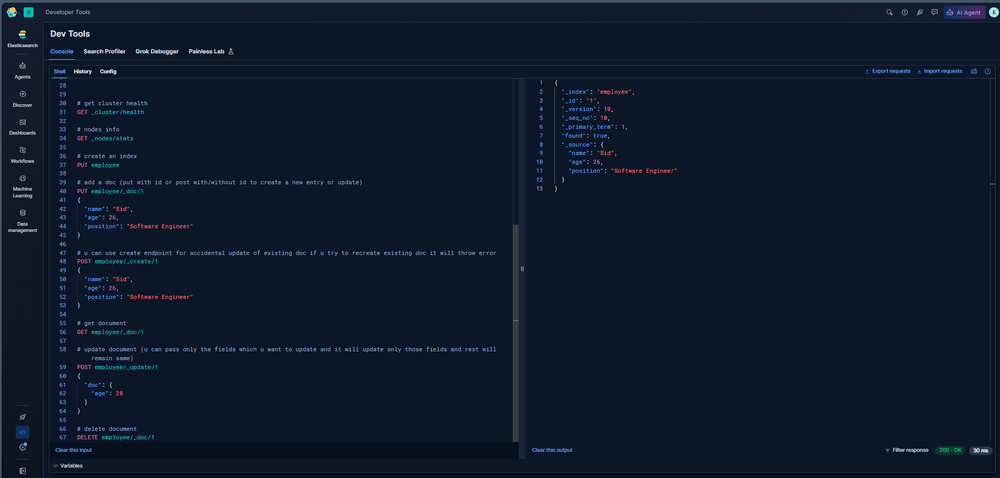

# 🔎 Learning Elasticsearch

## 📚 Table of Contents

- [Local Installation](#-local-installation)
- [Elasticsearch Overview](#-elasticsearch-overview)
- [Kibana Overview](#-kibana-overview)
- [Kibana Features](#-kibana-features)
- [Elasticsearch Architecture](#-elasticsearch-architecture)
- [CRUD Operations](#-crud-operations)

---

## 🚀 Local Installation

For local testing, Elasticsearch and Kibana can be installed as Docker containers by using the Elastic local setup script.

### 1️⃣ Download and Start Elasticsearch and Kibana

```bash
curl -fsSL https://elastic.co/start-local | sh
```

### 2️⃣ Start, Stop, or Uninstall the Stack

Change into the local Elastic stack directory and use the appropriate script:

```bash
cd elastic-stack-local

# Start Elasticsearch and Kibana
./start.sh

# Stop Elasticsearch and Kibana
./stop.sh

# Uninstall Elasticsearch and Kibana
./uninstall.sh
```

---

## 💡 Elasticsearch Overview

### What is Elasticsearch?

Elasticsearch is a distributed, open-source search and analytics engine that makes it possible to search, filter, and analyze large volumes of data very quickly.

It provides the ability to:

- Store data in **indexes**
- Search for documents
- Analyze data
- Aggregate and summarize results

### When should you use Elasticsearch?

Elasticsearch is useful when you need to:

- Search large amounts of data quickly
- Perform full-text searches
- Handle spelling mistakes with fuzzy search
- Rank and retrieve the most relevant data
- Run analytics and aggregations
- Analyze application or system logs

---

## 📊 Kibana Overview

### What is Kibana?

Kibana is a web-based visualization and management tool for Elasticsearch. It provides a graphical interface for running queries, visualizing data, and managing the Elasticsearch cluster.

### Why use Kibana?

Kibana helps you:

- Find all `ERROR` logs
- Count database failures that occurred today
- Identify APIs that take the longest to respond
- Visualize errors over time
- Monitor application performance

---

## 🧰 Kibana Features

| Feature | Purpose |
|---|---|
| **Discover** | Search and explore Elasticsearch documents |
| **Dashboard** | Create visual dashboards |
| **Visualize** | Create charts and graphs |
| **Dev Tools** | Execute Elasticsearch REST API queries |
| **Stack Management** | Manage indices, mappings, and related configurations |
| **Observability** | Monitor logs, metrics, and application performance |

---

## 🏗️ Elasticsearch Architecture

Elasticsearch organizes data in a cluster made up of one or more nodes.

```text
Cluster
└── Nodes
    └── Indexes
        └── Shards
            └── Replicas
```

- A **cluster** is a collection of one or more nodes.
- A **node** is an individual Elasticsearch server.
- An **index** contains documents and is similar to a table in a relational database.
- A **document** is a JSON object and is similar to a row in a table.
- A **shard** is a partition of an index.
- A **replica** is a copy of a shard used for fault tolerance and high availability.

### Index, Document, and JSON Data

An index is similar to a database table:

```text
Index: employee
```

A document is a JSON object stored inside the index, similar to a row in a table:

```json
{
  "name": "Sid",
  "age": 26,
  "position": "Software Engineer"
}
```

> **Tip:** An index can contain documents with different structures, but separate indexes are recommended for documents with significantly different schemas.

For example, the following documents could be stored in the same index:

#### Employee Document

```json
{
  "name": "Sid",
  "age": 26,
  "position": "Software Engineer"
}
```

#### Product Document

```json
{
  "productId": "345312",
  "name": "Samsung Galaxy S25",
  "price": 999.99
}
```

> **Note:** If documents in the same index share a field name but use incompatible data types, Elasticsearch can encounter mapping issues.

### 🧩 Shards

A shard is a partition of an index. Elasticsearch distributes shards across nodes, allowing search and indexing operations to run in parallel.

```text
employee_shard1  -> employees with IDs 1-1000
employee_shard2  -> employees with IDs 1001-2000
employee_shard3  -> employees with IDs 2001-3000
```

Shards improve performance by distributing search operations across the cluster.

### 🛡️ Replicas

A replica is a copy of a shard. Replicas provide:

- **Fault tolerance:** Data remains available if a primary shard or node fails.
- **High availability:** The cluster can continue operating without disruption.
- **Load balancing:** Replicas can help handle read/search requests.

```text
employee_shard1_replica1  -> copy of employee_shard1
employee_shard2_replica1  -> copy of employee_shard2
employee_shard3_replica1  -> copy of employee_shard3
```

---

## ✏️ CRUD Operations

Elasticsearch provides a RESTful API for performing CRUD operations on documents in an index. You can interact with the cluster using HTTP methods such as `POST`, `GET`, `PUT`, and `DELETE`.

The same operations can be executed in the **Kibana Dev Tools Console**.



_Example: Using Kibana Dev Tools to check cluster health, create an index, add and retrieve documents, update fields, and delete data._

### Request Syntax

```text
HTTP_METHOD  API_ENDPOINT
```

### Check Cluster Health

```http
GET _cluster/health
```

### View Node Statistics

```http
GET _nodes/stats
```

### Create an Index

```http
PUT employee
```

### Create or Replace a Document

Use `PUT` with a document ID to create a new document or replace an existing document.

```http
PUT employee/_doc/1
{
  "name": "Sid",
  "age": 26,
  "position": "Software Engineer"
}
```

Using `POST` without a document ID creates a new document and automatically generates an ID:

```http
POST employee/_doc
{
  "name": "Sid",
  "age": 26,
  "position": "Software Engineer"
}
```

> **How versions work:** When an existing document is replaced, Elasticsearch creates a new version and marks the old version as deleted.

### Prevent Accidental Document Updates

Use the `_create` endpoint when a document must be created only if the specified ID does not already exist.

If the document already exists, Elasticsearch returns an error instead of overwriting it:

```http
PUT employee/_create/1
{
  "name": "Sid",
  "age": 26,
  "position": "Software Engineer"
}
```

### Retrieve a Document

```http
GET employee/_doc/1
```

### Update a Document

The update API accepts only the fields that need to change. Fields that are not included remain unchanged.

```http
POST employee/_update/1
{
  "doc": {
    "age": 27
  }
}
```

### Delete a Document

```http
DELETE employee/_doc/1
```
